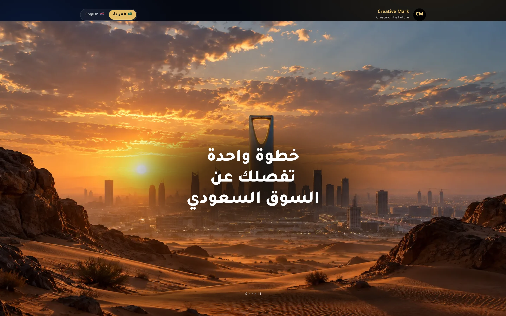
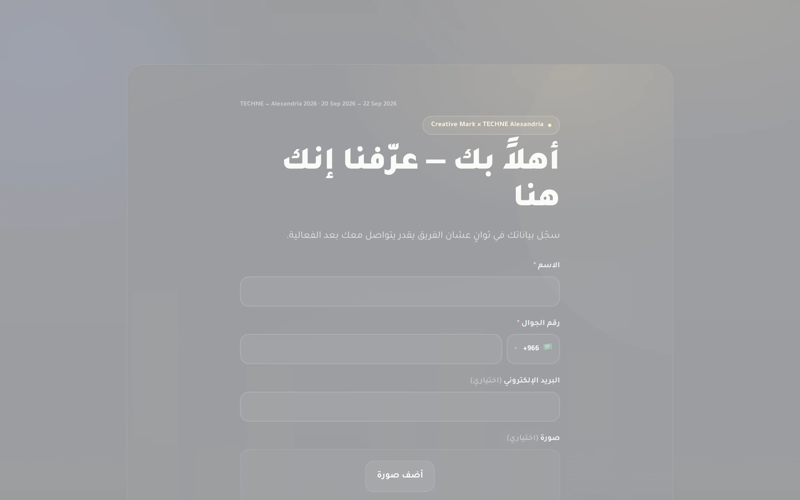
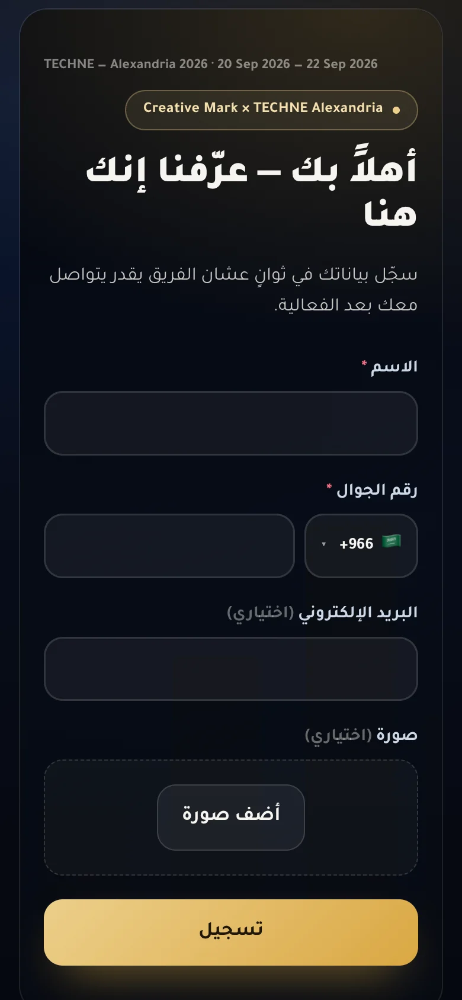
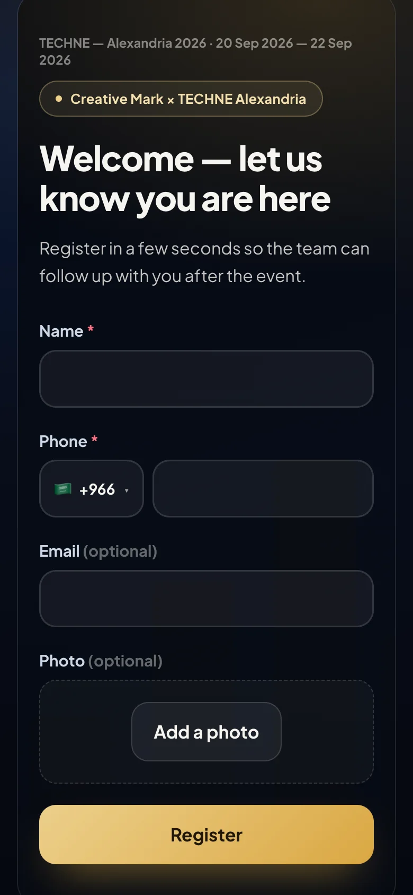
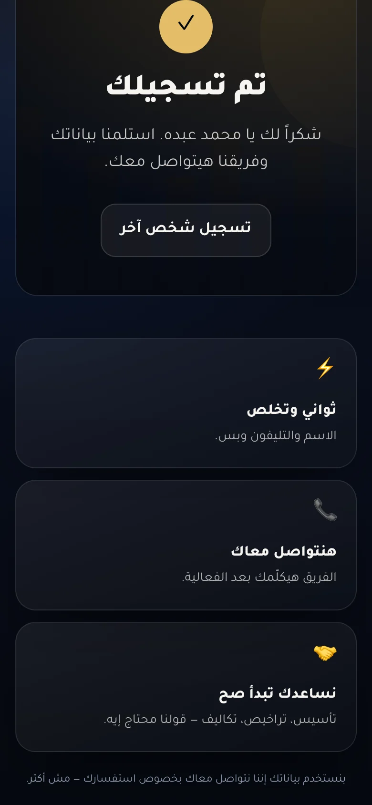
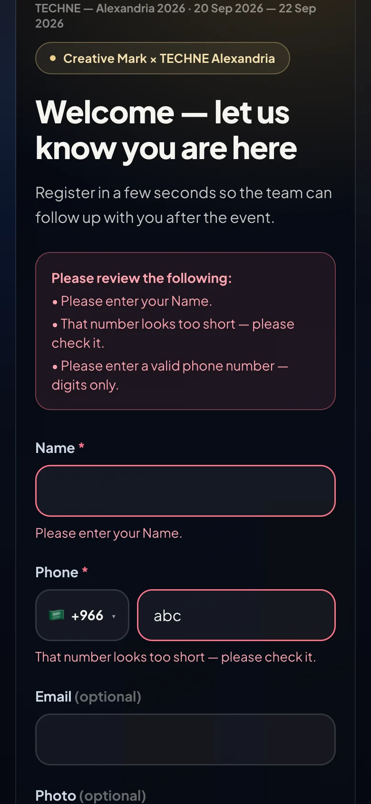
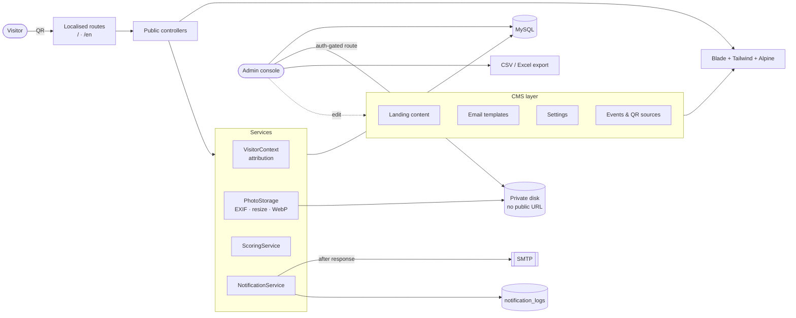

<div align="center">

# Saudi-Ready Check

**Event registration, market-readiness assessment and a small CRM — in one bilingual Laravel app.**

Built for Creative Mark and the **TECHNE — Alexandria 2026** event.

[](https://laravel.com)
[](https://php.net)
[](https://tailwindcss.com)
[](https://alpinejs.dev)
[](#testing)
[](#localisation)



</div>

---

## What it is

A visitor at a stand scans a QR code and lands on a scroll-driven opening sequence. The artwork
zooms into the Kingdom Centre's aperture, washes to white, and dissolves straight into a four-field
registration form. Name and phone are required; email and photo are optional. The sales team sees
the registration in the console immediately and gets an email about it.

The same codebase still serves the original **8-question readiness assessment** at `/quiz`, which
scores a visitor server-side and classifies them as a lead.

```
QR  ▸  Portal transition  ▸  Registration form  ▸  Confirmation
                                      │
                         private photo · sales email · CRM row
```

Everything is bilingual: Arabic is the default on un-prefixed URLs, English lives under `/en`,
and the whole interface mirrors for RTL.

---

## Screenshots

| The opening transition | Dissolving into the form |
| --- | --- |
|  |  |

| Registration · Arabic (RTL) | Registration · English (LTR) |
| --- | --- |
|  |  |

| Confirmation | Validation, where you can see it |
| --- | --- |
|  |  |

---

## Architecture



- **Thin controllers.** Request validation lives in form requests; the work lives in services.
- **Photos never touch the public disk.** They are stored under `storage/app/private`, which has no
  URL and no symlink into `public/`. The only way to read one is an authenticated admin route that
  streams the bytes.
- **Mail runs after the response.** The sales alert is internal, so the visitor does not wait for the
  SMTP round-trip. Failures still land in `notification_logs`.
- **Nothing is queued.** No worker, no cron, no Redis. Shared hosting runs this as-is.

---

## Features

### The registration flow

| | |
| --- | --- |
| **Scroll-driven portal** | A sticky stage, scroll-linked zoom and a white wash, driven by CSS custom properties written from plain JS. No animation library. Honours `prefers-reduced-motion`. |
| **Four fields, two required** | Name and phone. Email and photo are optional and say so. |
| **Phone normalisation** | A searchable country selector over 93 dial codes; numbers are normalised to E.164 server-side. |
| **Camera or gallery** | `accept="image/*"` with no `capture` attribute, so the OS offers both instead of forcing the camera. |
| **HEIC handling** | iPhone photos are converted to JPEG in the browser where the browser can decode them, and are never allowed to fail the registration if they cannot be. |
| **Photo pipeline** | EXIF orientation applied, then all metadata stripped (GPS included), downscaled to 1600px, stored as WebP at ~206 KB. |
| **A photo problem never costs a registration** | Rejected or unwritable photos save the row with `photo_path` null, log the reason, and tell the visitor. |

### The assessment flow

8 tap-only questions, server-side scoring, a classified result, and a lead record with its source,
UTM attribution, device and full answer breakdown.

### The console

Leads and registrations with filters and sorting, photo thumbnails behind authentication, CSV and
Excel export, an editable CMS for the public copy, email templates with live preview, QR source
management with scan counts, an analytics funnel, and role-based permissions.

---

## Stack

| Layer | Choice |
| --- | --- |
| Framework | Laravel 12 · PHP 8.2+ |
| Frontend | Blade · Tailwind CSS 4 · Alpine.js, bundled with Vite |
| Database | MySQL 8 (SQLite in-memory for tests) |
| Images | GD — EXIF rotate, strip, downscale, WebP |
| Mail | Laravel Mail over SMTP, sent synchronously after the response |
| Export | `maatwebsite/excel` |
| Auth | Session auth, optional Google OAuth for staff |
| Charts | Chart.js, admin only |

---

## Quick start

```bash
composer install
npm install

cp .env.example .env
php artisan key:generate            # then fill in your own values

php artisan migrate --seed
npm run build

php artisan serve
```

Arabic is served from `/`, English from `/en`, and the console from `/admin`.

---

## Testing

```bash
php artisan test
```

175 tests, 789 assertions. The suite runs against SQLite in memory and refuses to start if it is
pointed anywhere else — a cached config could otherwise aim `RefreshDatabase` at a real database.

Coverage includes the full submit path, both locales, the photo pipeline (rotation, metadata
stripping, downscale, WebP), rejected and unwritable photos, guest access to a private photo,
export column contract, rate limiting under a shared venue IP, and SMTP failure leaving the
registration intact.

---

## Localisation

Arabic is the default locale and keeps the original un-prefixed URLs, so QR codes already in
circulation keep working. English is served from `/en`, giving each language its own canonical URL
for `hreflang`.

Interface copy lives in `lang/{ar,en}`. Content the client edits lives in the database and **wins
over the lang files** — changing a lang file alone will not change a live page for a key that has
already been stored. `php artisan app:refresh-registration-copy` updates stored copy safely and is
idempotent.

---

## Deployment

Built for shared hosting where `symlink()` and `exec()` are unavailable.

```bash
php artisan route:clear && php artisan config:clear && php artisan view:clear
git fetch origin && git reset --hard origin/main
composer install --no-dev --optimize-autoloader
php artisan migrate --force
mkdir -p storage/app/private/registrations && chmod 750 storage/app/private/registrations
php artisan config:cache && php artisan route:cache && php artisan view:cache
```

Caches are cleared **before** the code changes underneath them, and rebuilt after. Compiled assets
are committed, so the server needs no Node toolchain. `php artisan storage:link` must never be run
here; the public storage link is created manually.

---

## Roadmap

Honest about what is not built yet.

- [ ] **Data retention.** No expiry or purge exists; registrations persist indefinitely.
- [ ] **Subject deletion.** Deleting one person and their photo together, rather than row by row.
- [ ] **Photo access log.** No record of which staff member viewed which photograph.
- [ ] **Consent on registration.** The assessment form records consent with a timestamp; the
      registration form only states the purpose.
- [ ] **Duplicate detection.** The same phone can register repeatedly with no warning.
- [ ] **Offline tolerance.** A failed submit on poor Wi-Fi relies on browser repopulation only.

---

## Recent changes

<!-- changes:start -->

| Commit | Date | Change |
| --- | --- | --- |
| `aebeee7` | 2026-10-01 | fix: never lose a registration to a photo problem; add sales notification |
| `741abcd` | 2026-10-01 | feat: event registration flow |
| `a4ba20e` | 2026-09-20 | create new requst |
| `19c96db` | 2026-09-20 | create new requst |
| `f4a27cb` | 2026-09-20 | create new requst |
| `786ab21` | 2026-09-20 | create new requst |
| `b641dcf` | 2026-09-20 | create new requst |
| `8a1bbd7` | 2026-09-20 | create new requst |
| `1076311` | 2026-09-20 | create new requst |
| `b3bd10f` | 2026-09-20 | create new requst |
| `ecb3b4a` | 2026-09-20 | create new requst |
| `63a3905` | 2026-09-17 | fix: harden automatic lead notifications |

<sub>Generated by <code>scripts/sync-readme.sh</code>.</sub>
<!-- changes:end -->

---

## Project layout

```
app/
  Http/Controllers/Public/     landing · quiz · registration
  Http/Controllers/Admin/      console
  Services/                    scoring · photos · notifications · attribution
  Exports/                     Excel and CSV
resources/
  views/public/                landing (portal + form) · quiz · result
  views/admin/                 console
  css · js                     Tailwind entry and Alpine components
lang/{ar,en}/                   interface copy
docs/screenshots/               the images in this file
```

---

<div align="center">
<sub>Creative Mark · Creating The Future</sub>
</div>
